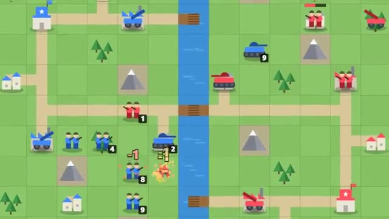

# Grid Tactics

Tanks, infantry, artillery. Capture their HQ. A multiplayer starter game from [Multiplayer Agent](https://multiplayeragent.com): 2D, turn-based, 2 players plus anyone who wants to watch, with a bot commander when you're alone.

## How it plays

Take turns moving your units across forests, mountains and roads, then fire. Forests, mountains and buildings give cover; artillery hits from two or three tiles away but can't move and fire in the same turn. Infantry capture cities for more gold each turn; spend it at your bases on new units. Capture the enemy HQ or wipe out their army to win, or own more buildings after 20 days.

**Controls:** Click or tap a unit, then a blue tile to drive or a red one to fire; tap your base to build. The red tiles show how much damage you'd do.

## Make it yours in the Game Builder

Open the [Game Builder](https://multiplayeragent.com), choose **Start from a starter game** and pick Grid Tactics. It opens as version 1 in your studio, ready to play and publish. Then ask for changes, for example:

- Add a helicopter that flies over rivers and mountains
- Draw a bigger map with a sea in the middle
- Add fog of war so you only see near your units

## Run it yourself

1. Get a free publishable key (`pk_…`) at [multiplayeragent.com](https://multiplayeragent.com).
2. In `index.html`, put it in place of `pk_REPLACE_ME` in the `MP_CONNECT` block.
3. Open `index.html` in a browser, or serve the folder (for example `npx serve`).

Without a key it still runs, offline against the bot commander.

## How it is built

- One `index.html`. The comment at the top of the script maps the code and explains the multiplayer. The map is a few rows of text in `CONFIG.map`.
- **Host-run rules:** The host's browser checks every move and plays the bot commander; if it leaves, the next player takes over.
- **Bots:** A bot commander plays the other side when you're alone, and a friend who joins takes over from it.
- **Live sync:** Both players and anyone watching see the same battle; it carries on if someone reloads while another player stays.
- **Leaderboard:** Most wins, shown after every battle.
- `?attract` runs it offline, bot against bot. The preview video is recorded from it.

## License

MIT.
